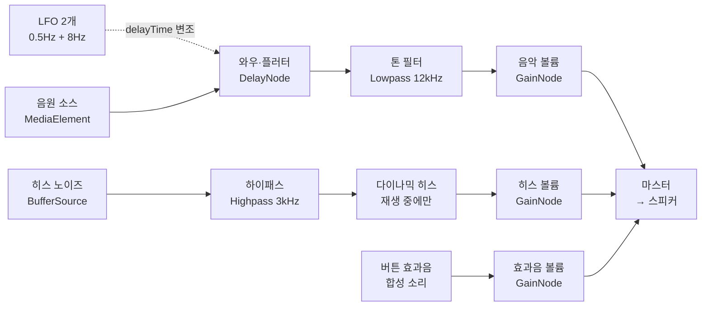

# Awesome Mix 카세트 MP3 플레이어 PRD

작성일: 2026-10-28 · 버전 1.2(2026-10-29: 이미지 합성 점검 결과 합의 사항 반영 — 5-1, 5-4, 6-6)

## 1. 개요

내 PC의 MP3 폴더를 실사풍 카세트테이프와 워크맨 화면으로 재생하는 레트로 플레이어를 만듭니다. AI(OpenRouter)는 곡 목록으로 테이프를 자동 구성하는 "믹스테이프 큐레이터" 한 가지에만 씁니다.

| 항목 | 내용 |
| --- | --- |
| 제품명(가칭) | Awesome Mix 카세트 플레이어 |
| 한 줄 정의 | 로컬 MP3를 카세트 감성으로 재생하고, 테이프 단위로 믹스를 만들어 선반에 꽂아 두는 웹 앱 |
| 대상 사용자 | 로컬 음원을 보유한 레트로 감성 음악 애호가, 바이브 코딩 학습자 본인 |
| 지원 환경 | PC 데스크톱의 크롬·엣지 최신 버전(File System Access API 필수), 최소 화면 폭 1024px |
| 기준 디자인 | 시안 A · Midnight Deck(확정), 실사풍 이미지 레이어 + 코드 애니메이션 |
| 배포 형태 | `index.html` 한 파일 + `assets/` 폴더(이미지와 assets.json). 로컬 서버(`http://localhost`)나 GitHub Pages 등 정적 호스팅에서 실행 |
| 구현 도구 | Claude Code(프로젝트 규칙은 `CLAUDE.md`) |
| 데이터 보관 | 모든 음원은 사용자 PC에만 존재, 테이프 구성과 폴더 핸들은 IndexedDB에 저장 |

### 목표

1. 폴더를 열고 5초 안에 첫 곡을 재생할 수 있다(곡 200개 기준).
2. 재생 중 릴 회전, 감긴 양 변화, 버튼 효과음이 실제 카세트처럼 느껴진다.
3. 재방문 시 권한 허락 한 번으로 선반의 테이프를 바로 다시 재생한다.
4. AI 큐레이터로 곡 목록에서 분위기별 테이프를 1분 안에 만든다.

### 범위에서 제외

- 모바일·사파리·파이어폭스 지원, 스트리밍 서비스 연동, 음원 편집·변환, 회원 가입과 클라우드 동기화

## 2. 사용자 시나리오

핵심 흐름은 "폴더 열기 → 테이프 만들기 → 덱에 넣기 → 재생"의 네 단계입니다.

### 시나리오 A: 처음 사용

1. 앱을 열면 빈 선반과 워크맨, "폴더 열기" 버튼이 보인다.
2. 폴더를 고르거나 MP3 파일을 화면에 끌어다 놓는다.
3. 앱이 ID3 태그를 읽어 "라이브러리" 목록을 보여 주고, 기본 테이프 "Awesome Mix Vol. 1"을 자동으로 만든다. 기본 테이프는 C90이며, 곡을 무작위로 섞어 면당 45분 안에서 덜 찬 면부터 채운다. 테이프는 선반에만 꽂히고, 사용자가 책등을 눌러 데크에 넣는다.
4. 테이프를 워크맨에 넣고 PLAY를 누르면 "철컥" 소리와 함께 릴이 돌기 시작한다.

### 시나리오 B: 직접 믹스테이프 만들기

1. "새 테이프"를 누르고 라벨 제목과 테이프 길이(C60·C90)를 고른다.
2. 라이브러리에서 곡을 끌어 A면·B면에 넣는다. 면마다 남은 시간이 표시되고, 초과하면 경고한다.
3. 저장하면 선반에 테이프 케이스가 꽂힌다.

### 시나리오 C: AI 큐레이터

1. "AI에게 믹스 부탁하기"에 "비 오는 밤 드라이브"처럼 분위기를 입력한다.
2. AI가 라이브러리에서 곡을 골라 A/B면 순서와 테이프 제목을 제안한다.
3. 사용자가 미리 보기에서 곡을 빼거나 순서를 바꾼 뒤 "선반에 꽂기"를 누른다.

### 시나리오 D: 재방문

1. 앱을 다시 열면 지난 선반이 그대로 보인다.
2. 테이프를 누르면 브라우저가 폴더 읽기 권한을 다시 묻고, 허락하면 마지막 위치부터 이어 듣는다.

## 3. 기능 요구사항

우선순위는 P0(MVP 필수), P1(1차 완성판), P2(여유가 있으면)의 세 단계입니다.

### 3-1. 음원 불러오기와 태그

| ID | 기능 | 상세 | 우선순위 |
| --- | --- | --- | --- |
| F-01 | 폴더 열기 | `showDirectoryPicker()`로 폴더를 고르고 하위 폴더까지 `.mp3`·`.m4a`·`.ogg`·`.flac`·`.wav`를 재귀 검색 | P0 |
| F-02 | 끌어다 놓기 | 파일·폴더를 창에 놓으면 추가. `DataTransferItem.getAsFileSystemHandle()`로 핸들까지 확보해 저장 가능하게 함 | P0 |
| F-03 | ID3 태그 읽기 | 제목·가수·앨범·연도·장르·앨범 아트. 태그가 없으면 파일 이름에서 "가수 - 제목" 추출 | P0 |
| F-04 | 재생 시간 파악 | 메타데이터로 곡 길이를 미리 계산(테이프 용량·릴 계산에 필요) | P0 |
| F-05 | 태그 캐시 | 읽은 태그를 IndexedDB에 보관(파일 경로+크기+수정 시각 키)해 재스캔 시간 단축 | P1 |
| F-06 | 스캔 진행 표시 | "테이프 녹음 중… 37/210" 같은 레트로 진행 표시 | P1 |

### 3-2. 카세트·워크맨 재생

| ID | 기능 | 상세 | 우선순위 |
| --- | --- | --- | --- |
| F-10 | 버튼 4종 | PLAY·STOP/EJECT·REW·FF. 실사 키 이미지를 쓰고, 누르면 아래로 1.5% 이동·밝기 0.88로 눌린 상태를 표현해 고정. STOP이 다른 키를 튀어오르게 함 | P0 |
| F-11 | "철컥" 효과음 | 버튼별 다른 기계음. 음원 파일 없이 Web Audio로 합성(노이즈 버스트+짧은 감쇠) | P0 |
| F-12 | REW·FF 동작 | 누르고 있는 동안 면 전체를 1초에 10초씩 이동, 릴이 빠르게 회전하고 "최아악" 감기는 소리 재생. 곡 경계를 넘어 이어짐 | P0 |
| F-13 | 릴 회전 | 재생 중에만 회전. 테이프 주행 속도가 일정하므로 감긴 양이 적은 릴이 더 빠르게 돈다 | P0 |
| F-14 | 감긴 양 변화 | 면 전체 진행률에 따라 왼쪽 릴은 줄고 오른쪽 릴은 커짐(계산식은 6-3, 위치는 assets.json) | P0 |
| F-15 | A면·B면 | 면마다 별도 트랙 목록. A면이 끝나면 자동 정지 후 "뒤집기" 애니메이션으로 B면 전환(설정에서 오토 리버스 선택) | P0 |
| F-16 | 일반 재생목록을 반으로 | 면 구분 없이 만든 목록은 재생 시간 합계가 비슷하도록 자동으로 반으로 나눔 | P0 |
| F-17 | 현재 곡 표시 | 데크 아래 호박색 LCD에 면·곡 번호·재생 상태, 경과/전체 시간, 제목·가수 표시. 앨범 아트는 테이프 케이스 인서물로 표현 | P0 |
| F-18 | 볼륨·트랙 건너뛰기 | 볼륨은 시안 A의 슬라이더(마우스 휠로도 조절). REW·FF를 0.3초보다 짧게 누르거나 Shift+←/→로 이전·다음 곡(데크 이미지의 볼륨 휠은 좌표가 없어 보류) | P1 |
| F-19 | 이어 듣기 | 테이프별 면·곡·위치를 저장해, 꺼냈다 다시 넣어도 그 자리부터 재생(진짜 테이프처럼) | P1 |
| F-20 | 키보드·미디어 키 | Space(PLAY/STOP), ←/→(누르고 있는 동안 REW/FF), Shift+←/→(이전·다음 곡), B(면 전환), E(꺼내기). Media Session API로 키보드 미디어 키와 OS 재생 카드 지원 | P1 |

### 3-3. 아날로그 효과

| ID | 기능 | 상세 | 우선순위 |
| --- | --- | --- | --- |
| F-30 | 테이프 히스 | 핑크 노이즈를 고역 통과해 아주 작게 섞음. 토글과 양 슬라이더 | P0 |
| F-31 | wow & flutter | 느린 흔들림(약 0.5Hz)과 빠른 떨림(약 6~10Hz)을 짧은 딜레이 변조로 구현. 기본값은 아주 약하게 | P0 |
| F-32 | 톤 색감 | 고음을 살짝 깎는 로패스(약 12kHz)와 약한 새추레이션으로 "테이프 느낌" | P1 |
| F-33 | 테이프 종류 | Normal·Chrome·Metal 프리셋(히스·로패스 값 묶음), 카세트 색상도 함께 바뀜 | P2 |

### 3-4. 테이프 선반(재생 목록)

| ID | 기능 | 상세 | 우선순위 |
| --- | --- | --- | --- |
| F-40 | 테이프 만들기·편집 | 라벨 제목, 길이(C46·C60·C90), 카세트 색, A/B면 곡 목록 끌어서 정렬 | P0 |
| F-41 | 선반 표시 | 테이프 케이스의 옆면(책등) 라벨이 보이게 꽂힌 선반. 마우스를 올리면 살짝 빠져나옴 | P0 |
| F-42 | 넣기·꺼내기 | 선반에서 데크로 끌거나 클릭하면 덮개가 열리고, 카세트가 위에서 내려와 칸에 자리 잡은 뒤 덮개가 닫힘. EJECT로 꺼냄(연출은 5-5) | P0 |
| F-43 | 저장·복원 | 선반 구성과 폴더 핸들을 IndexedDB에 저장, 재방문 시 `requestPermission()` 한 번으로 복원 | P0 |
| F-44 | 누락 곡 처리 | 파일이 옮겨지거나 지워지면 해당 곡을 회색으로 표시하고 건너뜀, "다시 찾기" 제공 | P1 |
| F-45 | 내보내기·가져오기 | 테이프 구성을 JSON으로 저장·불러오기(음원 제외, 상대 경로로 매칭) | P2 |
| F-46 | 인쇄용 J카드 | 테이프 곡 목록을 카세트 속지(J카드) 모양 PNG로 저장 | P2 |

### 3-5. AI 믹스테이프 큐레이터

| ID | 기능 | 상세 | 우선순위 |
| --- | --- | --- | --- |
| F-50 | 분위기로 테이프 만들기 | 분위기·상황을 입력하면 라이브러리에서 곡을 골라 A/B면 순서와 라벨 제목을 제안 | P1 |
| F-51 | 라이브러리 자동 분류 | 버튼 하나로 전체 곡을 3~6개 분위기 테이프로 나눠 제안 | P1 |
| F-52 | 제안 미리 보기 | 곡마다 선정 이유 한 줄, 빼기·순서 바꾸기 후 선반에 꽂기 | P1 |
| F-53 | API 키·모델 설정 | OpenRouter API 키 입력과 모델 선택(상세는 4장) | P1 |

## 4. AI 믹스테이프 큐레이터 상세

브라우저에서 OpenRouter Chat Completions API를 직접 호출하고, 음원이 아닌 곡 메타데이터(텍스트)만 보냅니다. 응답은 JSON으로 받아 앱이 검증한 뒤 미리 보기에 표시합니다.

### 4-1. 연동 방식

| 항목 | 내용 |
| --- | --- |
| 엔드포인트 | `POST https://openrouter.ai/api/v1/chat/completions` |
| 헤더 | `Authorization: Bearer <키>`, `Content-Type: application/json`, 선택적으로 `HTTP-Referer`(앱 주소)·`X-Title: Awesome Mix Player` |
| 모델 | 설정 화면에서 모델 ID를 직접 입력·선택. 기본값은 `openrouter/auto`, 비용을 아끼려면 저렴한 고속 모델 권장 |
| 응답 형식 | `response_format`에 JSON 스키마 지정. 미지원 모델이면 프롬프트로 JSON만 답하게 하고 코드 블록을 벗겨 파싱 |
| 타임아웃 | 60초. 실패 시 "테이프가 꼬였습니다" 메시지와 다시 시도 버튼 |
| 보내는 데이터 | 곡마다 `id`, 제목, 가수, 앨범, 연도, 장르, 길이(초). 음원·앨범 아트·파일 경로는 보내지 않음 |

### 4-2. API 키 처리

- 단일 HTML이라 서버가 없으므로, 사용자가 자기 키를 입력하고 브라우저에만 저장합니다(IndexedDB 또는 localStorage).
- 키를 코드에 넣거나 GitHub에 올리지 않습니다.
- OpenRouter에서 이 앱 전용 키를 따로 만들고 사용 한도(크레딧 제한)를 걸어 두길 권장합니다.
- 설정에 "키 삭제" 버튼을 두고, 키가 없으면 AI 메뉴만 숨겨 나머지 기능은 그대로 동작합니다.

### 4-3. 프롬프트 초안

시스템 프롬프트:

```text
당신은 1980년대 믹스테이프를 만드는 음악 큐레이터입니다.
주어진 라이브러리 곡 중에서만 고르고, 없는 곡을 지어내지 마십시오.
규칙:
- A면과 B면 각각의 총 길이가 side_seconds를 넘지 않게 합니다.
- A면 첫 곡은 인상적인 오프닝, A면 마지막 곡은 뒤집기 전 여운이 남는 곡으로 합니다.
- 같은 가수가 연속되지 않게 하고, 템포와 분위기가 자연스럽게 이어지게 합니다.
- 라벨 제목은 손글씨 라벨에 어울리는 30자 이내로 짓습니다.
- reason은 곡마다 한국어 한 문장(40자 이내)으로 씁니다.
반드시 지정된 JSON 형식으로만 답합니다.
```

사용자 메시지(앱이 조립):

```json
{
  "mood": "비 오는 밤 드라이브",
  "tape_length": "C60",
  "side_seconds": 1800,
  "library": [
    {"id": "t017", "title": "...", "artist": "...", "album": "...", "year": 1979, "genre": "Soul", "sec": 214}
  ]
}
```

기대하는 응답:

```json
{
  "tapes": [
    {
      "label": "Midnight Rain Drive",
      "color": "orange",
      "sideA": [{"id": "t017", "reason": "차분한 베이스로 밤길을 엽니다"}],
      "sideB": [{"id": "t102", "reason": "..."}]
    }
  ]
}
```

F-51(자동 분류)은 같은 형식에서 `tapes`를 3~6개 답하도록 요청합니다.

### 4-4. 응답 검증

1. 라이브러리에 없는 `id`와 중복 곡을 제거한다.
2. 면 길이가 `side_seconds`를 넘으면 끝에서부터 곡을 빼고 미리 보기에 "테이프 용량 초과로 제외"를 표시한다.
3. 곡이 하나도 남지 않으면 실패로 처리하고 다시 시도를 권한다.

### 4-5. 큰 라이브러리 대응

- 곡 1개당 약 30토큰으로 보면 500곡은 약 15,000토큰입니다.
- 500곡을 넘으면 키 이름을 짧게 줄이고(예: `t`·`a`·`g`), 그래도 많으면 장르·연도로 후보를 먼저 걸러 500곡 이하만 보냅니다.
- 호출 전에 "약 N곡을 보냅니다"를 보여 주어 비용을 예상할 수 있게 합니다.

## 5. 디자인 가이드

디자인은 **시안 A · Midnight Deck**으로 확정했습니다. 어두운 하이파이 오디오 기기 분위기이고, 데크·카세트·키·헤드폰은 실사풍 이미지 레이어로, 움직이는 부분만 코드로 그립니다. 화면 구성·색·서체는 `design/design-A-midnight-deck.html`(시안 A)을, 이미지 제작 규칙은 `design/image-spec.md`를 따릅니다. 영화 로고·스틸·실제 제품 디자인은 쓰지 않습니다.

### 5-1. 화면 배치(데스크톱, 시안 A)

- **상단 띠**: 왼쪽에 워드마크 "AWESOME MIX"(Archivo Narrow, 자간 넓게)와 부제 "STEREO TAPE DECK · 로컬 MP3 플레이어". 오른쪽에 폴더 열기, HISS 토글, WOW & FLUTTER 토글(켜지면 호박색 LED), 설정 버튼.
- **1행 왼쪽(넓게)**: 데크 패널. 실사 데크 이미지 안에 카세트가 들어가고, 아래에 호박색 LCD(면·곡 번호·재생 상태, 경과/전체 시간, 제목, 가수)와 카운터, 키 4개, 볼륨 슬라이더, "B면으로 뒤집기" 버튼. 패널 오른쪽 위에 주황 폼 헤드폰 이미지가 걸침.
  - 데크 이미지는 패널 폭에 맞춰 최대 약 900px까지 키운다(시안 A의 600px로는 실사 키 높이가 약 33px밖에 되지 않음).
  - LCD는 둘로 나눈다. 데크 이미지의 LCD 창(`deck.lcd`)에는 면·재생 상태·카운터만 짧게 넣고, 데크 아래 시안 A의 큰 LCD 패널에 제목·가수·경과/전체 시간을 표시한다.
- **1행 오른쪽**: J카드 패널(아이보리 종이). 손글씨 테이프 제목, SIDE A/B 탭, 테이프 용량 막대("28:01 / 30:00"), 곡 목록(현재 곡은 짙은 배경으로 반전).
- **2행 왼쪽**: 테이프 선반. 책등이 보이게 꽂힌 테이프, 데크에 들어간 테이프는 18px 솟고 주황 테두리, AI가 만든 테이프는 청록 "AI" 배지, "+ 새 테이프" 버튼.
- **2행 오른쪽**: AI 믹스테이프 큐레이터 패널(짙은 청록). 분위기 입력칸, 추천 칩 3개, "믹스 만들기 · C60" 버튼, 개인정보 안내 한 줄.
- **라이브러리**: 시안 A에는 패널이 없으므로, 상단 띠의 "라이브러리" 버튼으로 오른쪽 서랍을 열어 전체 곡과 재생 불가 곡을 보여 줍니다. 재생은 J카드(테이프)로만 하고, M5의 테이프 편집기도 이 서랍을 씁니다.
- 창이 좁아지면 각 행의 두 패널이 세로로 쌓입니다. 공식 지원 폭은 1024px 이상이지만, 그보다 좁아도 깨지지 않게 합니다.

### 5-2. 색상 토큰

| 토큰 | 값 | 용도 |
| --- | --- | --- |
| `--bg` | #0D0D0E | 페이지 배경 |
| `--panel` | #17171A | 데크·선반 패널 |
| `--line` | #2A2A2F | 패널 테두리 |
| `--key` | #232328 | 일반 버튼 |
| `--text` | #ECE7DF | 본문 |
| `--muted` | #9A958C | 보조 글자 |
| `--accent` | #F2772A | PLAY, 헤드폰 폼, 선택 상태 |
| `--lcd-bg` / `--lcd` | #1A1306 / #FFB547 | LCD 바탕과 글자 |
| `--paper` / `--ink` | #EDE4CF / #1C1A17 | J카드 종이와 글자 |
| `--pen` | #1D2A8C | 손글씨(파란 펜) |
| `--ai` / `--ai-bg` | #3FB8A8 / #12201E | AI 큐레이터 강조색과 패널 |
| `--shelf` | #3A2A1E | 선반 나무판 |

### 5-3. 서체(Google Fonts)

| 용도 | 서체 |
| --- | --- |
| 기계 각인, 버튼 라벨 | Archivo Narrow 500·600·700 |
| 본문(한글) | IBM Plex Sans KR 400·500·700 |
| 시간·숫자 | IBM Plex Mono 500 |
| 카운터 | VT323 |
| 손글씨 라벨(영문) | Permanent Marker |
| 손글씨 라벨(한글), J카드 제목 | Nanum Pen Script |

### 5-4. 실사 이미지 레이어

이미지는 `assets/` 아래에 있고, 위치·크기는 `assets/assets.json`(6-6)에 적힌 좌표를 따릅니다. 파일 경로도 assets.json에 적힌 그대로 쓰므로 PNG·WebP 어느 쪽이든 됩니다.

| 파일 | 내용 | 코드에서 하는 일 |
| --- | --- | --- |
| `deck/deck-bay@2x` | 덮개 없는 데크 본체(빈 카세트 칸, LCD 창, 긴 키 홈) | 맨 아래에 고정 |
| `deck/deck-lid@2x` | 덮개 테두리(유리창 부분 투명), 본체와 같은 캔버스 크기 | `hingeY`를 축으로 `rotateX` 열림·닫힘, 유리 색·반사광은 CSS |
| `deck/key-rew·play·stop·ff@2x` | 기호 없는 키 4개 | `keyChannel`을 4등분해 배치, 기호는 CSS로 음각처럼, 누르면 아래로 1.5% 이동 + 밝기 0.88 |
| `deck/headphones@2x` | 주황 폼 헤드폰 | `headphones.place` 위치에 배치(데크 이미지 좌표 기준) |
| `cassette/cassette-shell@2x` | 카세트 셸(창·허브 구멍 투명) | 감긴 테이프·허브를 셸 아래 층에 코드로 그림 |
| `cassette/cassette-label@2x` | 빈 라벨 종이 | 색 띠·손글씨 제목·A/B 표기를 CSS로 얹음 |
| (선택) `cassette/cassette-hub`, `tape-pack-texture`, `shelf/case-spine` | 허브·테이프 질감·케이스 책등 | 있으면 쓰고, 없으면 CSS·SVG로 대체. `case-spine`은 이미지 둘레의 투명 여백 때문에 띠·글자를 맞출 수 없어 지금은 쓰지 않음(케이스에 딱 맞게 자르면 사용) |

이미지를 불러오지 못하면 시안 A의 CSS 데크로 대체해, 앱이 멈추지 않게 합니다.

- `deck-lid`의 유리창 부분은 반드시 투명해야 합니다. 그래야 덮개를 닫아도 카세트와 릴이 보입니다. 유리 색과 반사광은 코드로 얹습니다.
- 카세트는 허브를 스핀들에 맞추느라 칸보다 크게 놓일 수 있습니다. 그래서 카세트 레이어는 `deck.bay` 사각형 안으로 잘라 그립니다.

### 5-5. 애니메이션과 상호작용

| 장면 | 연출 |
| --- | --- |
| PLAY | 키가 눌림(코드), "철컥", 릴 회전 시작(0.3초 가속) |
| STOP/EJECT | 재생 중이면 정지하고 눌린 키가 튀어오름. 정지 상태에서 한 번 더 누르면 덮개가 35도 열림(0.35초) |
| 카세트 넣기 | 덮개가 열린 상태에서 선반 테이프 선택 → 카세트가 위에서 내려와 `seatInBay`에 자리 잡음(0.4초) → 덮개 닫힘, "딱" |
| 카세트 꺼내기 | 덮개 열림 → 카세트가 위로 올라가 선반으로 돌아감 |
| REW·FF | 테이프 이동(1초에 10초)과 맞춰 릴 회전 10배, 모터 소리, LCD 시간이 빠르게 변함 |
| 면 전환 | 덮개 열림 → 카세트가 Y축으로 180도 뒤집힘(라벨 A↔B) → 다시 들어감 → 덮개 닫힘 |
| 히스·와우 켜짐 | 토글의 LED가 호박색으로 켜짐 |
| 테이프 끝 | 릴 정지, "딱", PLAY 키가 튀어오름 |
| 움직임 줄이기 설정 | 뒤집기·비행은 페이드로 대체, 릴 회전은 유지하되 느리게 |

### 5-6. 저작권 체크리스트

- [ ] 영화 제목·로고·캐릭터·스틸 이미지를 쓰지 않았다.
- [ ] 실제 제조사의 상표명과 제품 모양을 그대로 복제하지 않았다.
- [ ] AI로 만든 이미지에 로고·글자·상표가 없다.
- [ ] 폰트는 모두 오픈 라이선스(Google Fonts 등)다.
- [ ] 효과음은 직접 합성하거나 CC0 자료다.

## 6. 기술 설계

앱 코드는 빌드 도구 없이 `index.html` 하나에 담고, 실사 이미지와 좌표는 `assets/` 폴더에 둡니다.

### 6-1. 파일 구조

빌드 도구 없이, 앱 코드는 `index.html` 하나에 HTML·CSS·JS를 모두 넣습니다. 이미지와 좌표는 `assets/` 폴더에 따로 둡니다. 외부 라이브러리는 태그 읽기용 jsmediatags 하나만 CDN으로 불러옵니다.

```text
awesome-mix/
├─ index.html            앱(HTML·CSS·JS 한 파일)
├─ assets/
│  ├─ assets.json        이미지 좌표(tools/calibrate.html로 만듦)
│  ├─ deck/              deck-bay, deck-lid, key-rew·play·stop·ff, headphones
│  ├─ cassette/          cassette-shell, cassette-label (+선택: cassette-hub, tape-pack-texture)
│  └─ shelf/             (선택) case-spine
├─ docs/                 PRD
├─ design/               시안 A, 이미지 명세
├─ tools/                calibrate.html, gen.py, prep.py, prompts.json, check-assets.py, make-test-audio.py
└─ CLAUDE.md             Claude Code 작업 규칙
```

`index.html` 안의 구성:

```text
<head>   Google Fonts, jsmediatags (cdnjs, 버전 고정)
<style>  5-2 색상 토큰(CSS 변수), 데크·카세트·선반·J카드, 키프레임
<body>   상단 띠 / 데크 패널 / J카드 / 선반 / AI 패널 / 대화상자
<script type="module">
  Assets     assets.json 읽기, 이미지 미리 불러오기, 좌표를 %로 변환
  Store      IndexedDB 읽기·쓰기 (roots, tracks, art, tapes, settings)
  Library    폴더 스캔, 태그·길이 읽기, 권한 재요청
  Engine     AudioContext, 재생·이동, 히스·와우, 효과음 합성
  Deck       테이프 상태 머신(STOP·PLAY·REW·FF·EJECT·LID_OPEN), 면 전환, 넣기·꺼내기
  Reels      requestAnimationFrame으로 릴 각도·반지름 갱신
  Shelf      테이프 목록 렌더, 끌어서 넣기, 편집기
  Curator    OpenRouter 호출, 응답 검증, 미리 보기
```

### 6-2. 오디오 그래프

음악만 테이프 효과를 거치고, 효과음은 곧장 마스터로 갑니다.



히스·와우 토글은 해당 게인과 변조 깊이를 0으로 내리는 방식이라, 노드를 다시 연결할 필요가 없습니다.

곡은 `<audio>` 요소에 Blob URL을 넣어 재생하고, `MediaElementAudioSourceNode`로 Web Audio에 연결합니다. AudioContext는 첫 PLAY 클릭 때 `resume()`합니다.

| 매개변수 | 기본값 | 비고 |
| --- | --- | --- |
| 기본 지연 | 10ms | 변조의 중심값 |
| wow | 0.5Hz, 깊이 0.6ms | 피치 흔들림 약 ±0.19% |
| flutter | 8Hz, 깊이 0.01ms | 피치 떨림 약 ±0.05% |
| 히스 | 핑크 노이즈 4초 루프, 게인 0.008(약 -42dB) | 슬라이더로 0~0.03 |
| 톤 | Lowpass 12kHz, Q 0.7 | F-32 |
| 다이나믹 히스 | 정지·일시정지 때 히스 게인 0 | 실제 테이프처럼 멈추면 조용해짐 |

피치 변화율은 지연 시간 변조의 기울기로 정해집니다(깊이 A, 주파수 f).

$$
\frac{\Delta p}{p} \approx 2\pi f A
$$

REW·FF는 음악을 음소거한 채 `currentTime`을 옮기고, 대신 합성한 모터 소리를 재생합니다.

### 6-3. 릴 계산

테이프는 일정한 속도로 감기므로, 릴에 감긴 테이프의 넓이가 남은 비율 f에 비례합니다. 허브 반지름 r_h는 `cassette.hubs`의 반지름, 가득 찼을 때 반지름 r_max는 `cassette.packMaxRadius`로 둡니다(6-6).

$$
r = \sqrt{r_h^2 + f\,(r_{max}^2 - r_h^2)}
$$

회전 속도는 반지름에 반비례합니다(v는 화면상 테이프 속도).

$$
\omega = v / r
$$

- 왼쪽 릴의 f는 1 − (면에서 지난 시간 ÷ 면 전체 시간), 오른쪽 릴은 그 나머지입니다.
- 면 전체 시간은 기본적으로 곡 길이 합계이고, 설정에서 "실제 테이프 길이 기준"(C60이면 30분)으로 바꿀 수 있습니다.
- 면을 뒤집으면 다시 왼쪽이 가득 찬 상태로 시작합니다.
- 감긴 테이프 원은 카세트 셸 이미지 **아래** 층에 그리고, 중심은 `cassette.hubs`의 좌표입니다. 좌표는 카세트 이미지 크기에 대한 %로 바꿔 쓰므로 화면 크기가 바뀌어도 맞습니다.
- 허브는 SVG(또는 선택 이미지 `cassette-hub`)를 셸 구멍 위치에 두고 `transform: rotate()`를 매 프레임 갱신합니다.

### 6-4. 데이터 모델(IndexedDB)

| 저장소 | 키 | 내용 |
| --- | --- | --- |
| roots | rootId | `FileSystemDirectoryHandle`, 폴더 이름 |
| tracks | trackId | rootId, 상대 경로, 파일 크기·수정 시각, 제목·가수·앨범·연도·장르·길이(초), artKey |
| art | artKey | 앨범 아트 Blob(256px로 축소, 같은 앨범은 공유) |
| tapes | tapeId | 라벨, 색, 길이(C46·C60·C90), sideA·sideB(trackId 배열), 이어 듣기 위치, 만든 방식(직접·AI), 선반 순서 |
| settings | app | 히스·와우·톤 값, 오토 리버스, OpenRouter 키, 모델 ID |

핸들을 얻지 못한 끌어다 놓기 파일은 "임시 곡"으로 표시하고, 새로 고침하면 사라진다고 알립니다.

### 6-5. 사용하는 브라우저 API

| API | 용도 |
| --- | --- |
| File System Access (`showDirectoryPicker`, `queryPermission`, `requestPermission`) | 폴더 열기와 권한 복원 |
| IndexedDB | 핸들·태그·테이프·설정 저장 |
| Web Audio | 효과 그래프와 효과음 합성 |
| Media Session | 미디어 키, OS 재생 카드(제목·앨범 아트) |
| Fetch | assets.json 읽기, OpenRouter 호출 |

### 6-6. 이미지 좌표 파일(assets/assets.json)

AI 이미지는 부품 위치가 매번 달라서, 이미지마다 좌표를 재서 `assets/assets.json`에 적고 앱은 그 값만 따릅니다. 이미지를 바꿔도 코드는 고칠 필요가 없습니다. 파일은 `tools/calibrate.html`에서 이미지 위에 끌어서 표시한 뒤 내려받아 만듭니다.

- 단위는 각 이미지(@2x) 기준 픽셀입니다. `[x, y, 너비, 높이]`는 왼쪽 위 기준 사각형, `[cx, cy, r]`은 원의 중심과 반지름입니다.
- 앱은 좌표를 이미지 크기에 대한 %로 바꿔 CSS에 씁니다.
- `seatInBay`와 `headphones.place`는 **데크 이미지 좌표**로 적습니다(헤드폰은 데크 밖으로 나가도 되므로 음수·초과 값 가능).

```json
{
  "version": 1,
  "deck": {
    "image": "deck/deck-bay@2x.webp",
    "size": [2048, 1536],
    "bay": [0, 0, 0, 0],
    "spindles": { "left": [0, 0, 0], "right": [0, 0, 0] },
    "lcd": [0, 0, 0, 0],
    "keyChannel": [0, 0, 0, 0],
    "lid": { "image": "deck/deck-lid@2x.webp", "hingeY": 0 }
  },
  "keys": {
    "files": {
      "rew": "deck/key-rew@2x.webp",
      "play": "deck/key-play@2x.webp",
      "stop": "deck/key-stop@2x.webp",
      "ff": "deck/key-ff@2x.webp"
    },
    "pressed": { "translateY": "1.5%", "brightness": 0.88 }
  },
  "cassette": {
    "image": "cassette/cassette-shell@2x.webp",
    "label": "cassette/cassette-label@2x.webp",
    "size": [1260, 800],
    "labelArea": [0, 0, 0, 0],
    "window": [0, 0, 0, 0],
    "hubs": { "left": [0, 0, 0], "right": [0, 0, 0] },
    "packMaxRadius": 0,
    "seatInBay": [0, 0, 0, 0]
  },
  "headphones": {
    "image": "deck/headphones@2x.webp",
    "size": [1200, 800],
    "place": [0, 0, 0, 0]
  }
}
```

| 키 | 의미 | 앱에서 쓰는 곳 |
| --- | --- | --- |
| `deck.bay` | 빈 카세트 칸의 안쪽 사각형 | 카세트가 내려오는 범위, 카세트 레이어를 자르는 영역 |
| `deck.spindles` | 칸 안 흰 스핀들의 중심과 반지름 | 카세트 허브를 맞추는 기준점 |
| `deck.lcd` | 빈 LCD 창의 안쪽 사각형 | LCD 글자 위치 |
| `deck.keyChannel` | 키가 들어갈 긴 홈의 안쪽 사각형 | 4등분해 키 배치, 클릭 영역 |
| `deck.lid.hingeY` | 덮개 경첩이 있는 가로선의 y | `rotateX`의 회전축 |
| `keys.files` | 키 이미지 4개의 경로 | 키 표시 |
| `keys.sizes` | 키 이미지 4개의 크기 `[너비, 높이]` | 키 늘이기 계산 |
| `keys.pressed` | 눌린 상태 표현값 | 키를 누를 때의 이동·밝기 |
| `keys.layout` | 키 배치 방식. `mode`(`stretch`: 홈에 꽉 차게 가운데만 늘림, `contain`: 비율 유지), `gap`(키 사이 간격, 데크 px), `inset`(위·아래 여백), `edge`(늘리지 않고 보존할 양쪽 가장자리 비율) | `keyChannel`을 4칸으로 나눠 키를 그림(calibrate.html의 미리 보기와 같은 방식) |
| `cassette.labelArea` | 셸의 빈 라벨 자리 | 라벨 종이·색 띠·손글씨 제목 |
| `cassette.window` | 가운데 투명창 | 창 유리 레이어 |
| `cassette.hubs` | 허브 구멍 2개의 중심과 반지름 | 릴 회전 중심, 감긴 테이프의 최소 반지름 |
| `cassette.packMaxRadius` | 감긴 테이프가 가득 찼을 때의 반지름 | 6-3의 r_max |
| `cassette.seatInBay` | 칸에 넣은 카세트가 놓일 사각형(데크 좌표) | 넣기 애니메이션의 도착 위치 |
| `headphones.place` | 헤드폰을 놓을 사각형(데크 좌표) | 헤드폰 위치 |
| `optional` | 선택 이미지 경로(`cassetteHub`, `tapePackTexture`, `caseSpine`) | 있으면 쓰고, 없으면 CSS·SVG로 대체 |

`tools/check-assets.py`로 파일 존재, 빈 좌표, 허브와 스핀들 정렬, 덮개 유리창 투명 여부를 점검합니다.

`assets.json`은 `fetch('assets/assets.json')`으로 읽으므로, 앱은 `file://`가 아니라 로컬 서버(`http://localhost`)나 https에서 열어야 합니다(7장).

## 7. 비기능 요구사항

| 구분 | 기준 |
| --- | --- |
| 성능 | 곡 200개 폴더는 첫 스캔 10초 이내, 캐시가 있으면 2초 이내. 태그는 동시 4개씩 읽고, 스캔 중에도 재생 가능 |
| 애니메이션 | 릴·버튼은 60fps 목표. `transform`·`opacity`·`filter`만 애니메이션하고, 창이 숨겨지면 rAF 중단 |
| 메모리 | 재생 중인 곡과 다음 곡만 Blob URL을 만들고, 끝난 곡은 `revokeObjectURL()` |
| 브라우저 | 크롬·엣지 최신 2개 버전. 그 외 브라우저는 첫 화면에서 "크롬·엣지에서 열어 주세요" 안내 |
| 실행 주소 | `assets.json`을 fetch로 읽고 File System Access API도 보안 컨텍스트가 필요하므로 `http://localhost`(예: `python3 -m http.server 8000`, Windows는 `python -m http.server 8000`)나 https에서 실행. `file://`로 열면 로컬 서버로 여는 방법을 안내 |
| 이미지 로딩 | 데크·카세트 이미지는 첫 화면 전에 미리 불러오고, 실패하면 시안 A의 CSS 데크로 대체 |
| 접근성 | 모든 버튼에 `aria-label`·`aria-pressed`, 키보드만으로 전체 조작, `prefers-reduced-motion`이면 뒤집기·비행 애니메이션을 페이드로 대체 |
| 개인정보 | 음원·경로는 PC 밖으로 나가지 않음. AI 호출 때만 곡 메타데이터가 OpenRouter와 선택한 모델 제공사로 전송됨을 처음 한 번 고지 |
| 오류 처리 | 읽을 수 없는 파일·권한 거부·API 실패를 레트로 알림창으로 표시하고 앱은 계속 동작 |
| 파일 크기 | `index.html` 300KB 이하(폰트·라이브러리 제외), `assets/` 전체 1.5MB 이하(WebP 권장) |

## 8. 개발 단계와 Claude Code 프롬프트

Claude Code로 단계마다 하나씩 구현합니다. 재생이 먼저 되게 한 뒤 실사 데크와 효과를 입히는 순서입니다. 하루 2~3시간 작업 기준으로 약 10~12일을 예상합니다.

| 단계 | 목표 | 포함 기능 | 예상 기간 | 완료 확인 |
| --- | --- | --- | --- | --- |
| M0 준비 | 프로젝트 폴더와 이미지 좌표가 갖춰진다 | 폴더 구조, CLAUDE.md, assets.json, 테스트 음원 | 0.5일 | `http://localhost:8000`에서 빈 화면이 열림 |
| M1 재생 뼈대 | 폴더를 열고 곡이 나온다 | F-01~04, F-10, F-16 | 1일 | 목록에서 곡을 눌러 재생·정지 |
| M2 실사 데크·카세트 | 시안 A 화면에 실사 데크가 보인다 | 5장, 6-3, 6-6, F-13~15, F-17 | 3일 | 릴이 돌고 감긴 양이 변하며, 덮개가 열리고 카세트가 들어감 |
| M3 조작감 | 키가 기계처럼 움직인다 | F-11~12, F-18, F-20, 키 눌림(코드) | 2일 | "철컥"과 REW·FF 소리, 눌린 키 표현 |
| M4 아날로그 효과 | 테이프 소리가 난다 | F-30~32 | 1일 | 토글로 히스·와우 켜고 끔 |
| M5 선반과 저장 | 테이프를 만들고 다시 열어도 남는다 | F-05~06, F-19, F-40~44 | 2일 | 새로 고침 후 권한 허락만으로 재생 |
| M6 AI 큐레이터 | 분위기로 테이프를 만든다 | F-50~53 | 1~2일 | 제안이 면 용량 안에 들어오고 선반에 꽂힘 |
| 마무리 | 다듬기와 P2 | F-33, F-45~46, 9장 수용 기준 점검 | 여유에 따라 | 수용 기준 모두 통과 |

### Claude Code 사용 방법

- 프로젝트 폴더 맨 위에 `CLAUDE.md`를 두면, Claude Code가 매번 이 규칙을 읽고 시작합니다.
- 단계마다 새 대화로 시작하고, 먼저 계획을 받아 확인한 뒤 구현하게 합니다(Shift+Tab으로 계획 모드).
- 단계가 끝날 때마다 git 커밋을 해 두면, 잘못되었을 때 되돌리기 쉽습니다.
- 화면 확인은 Claude Code에게 로컬 서버를 띄우고 스크린샷을 찍어 시안 A와 비교하게 하면 됩니다.

### 단계별 프롬프트

1. **M0**: "CLAUDE.md와 docs/Awesome_Mix_PRD_v2.md를 읽어 줘. 6-1의 폴더 구조대로 빈 index.html을 만들고, 로컬 서버로 여는 방법을 README.md에 정리해 줘. 테스트용 MP3 6곡을 ffmpeg로 만드는 스크립트(test-audio/, 서로 다른 ID3 태그·길이)도 만들어 줘. assets/assets.json이 있는지, 적힌 이미지 파일이 모두 있는지 검사하는 작은 스크립트도 부탁해."
2. **M1**: "PRD 3-1과 F-10, F-16을 구현해 줘. showDirectoryPicker로 폴더를 고르면 하위 폴더의 오디오 파일을 찾고, jsmediatags(cdnjs, 버전 고정)로 제목·가수·앨범 아트를 읽어 목록을 보여 줘. 곡 길이를 구하고, 재생 시간 합계가 비슷하게 A면·B면으로 나눠 줘. 파일 끌어다 놓기도 지원해 줘. 디자인은 아직 신경 쓰지 않아도 돼."
3. **M2**: "PRD 5장과 6-3, 6-6, design/design-A-midnight-deck.html을 보고 시안 A 화면을 만들어 줘. 데크는 assets/assets.json의 좌표로 deck-bay, 카세트(셸 아래에 감긴 테이프와 허브), deck-lid, 키, 헤드폰을 겹쳐 그려 줘. 좌표는 이미지 크기에 대한 %로 바꿔 써야 해. 릴은 6-3 공식대로 움직이고, 5-5의 덮개 열림·카세트 넣기 애니메이션도 넣어 줘. 이미지가 없으면 시안 A의 CSS 데크로 대체해 줘."
4. **M3**: "키 4개를 기계식으로 눌리게 해 줘. 눌린 상태는 assets.json의 keys.pressed 값(아래로 1.5%, 밝기 0.88)으로 표현하고, 효과음은 Web Audio로 합성해 줘. REW·FF는 누르는 동안 면 전체를 이동하고, 키보드 단축키와 Media Session도 추가해 줘."
5. **M4**: "6-2의 오디오 그래프와 기본값대로 테이프 히스와 wow & flutter를 만들고, 상단 띠의 HISS·WOW 토글과 LED에 연결해 줘."
6. **M5**: "6-4의 IndexedDB 구조로 테이프 선반을 만들어 줘. 테이프 만들기·편집, 선반에서 데크로 넣기, 이어 듣기, 재방문 시 requestPermission으로 폴더 권한 복원을 구현해 줘."
7. **M6**: "4장 사양대로 OpenRouter를 호출하는 AI 큐레이터 패널을 만들어 줘. 키와 모델은 설정에서 입력받아 브라우저에만 저장하고, 응답은 4-4 규칙으로 검증한 뒤 미리 보기를 거쳐 선반에 꽂아 줘."

## 9. 수용 기준, 리스크, 향후 확장

### 9-1. 수용 기준

- [ ] 크롬에서 폴더를 열고 5초 안에 첫 곡을 재생할 수 있다(곡 200개 기준).
- [ ] 태그가 없는 파일도 파일 이름으로 제목·가수가 표시된다.
- [ ] 재생 중에만 릴이 돌고, A면 끝에서 왼쪽 릴이 비고 오른쪽 릴이 가득 찬다.
- [ ] 카세트 허브가 데크 스핀들 위에 정확히 놓이고, 감긴 테이프가 셸 창 안에서만 보인다.
- [ ] 덮개가 열리고 카세트가 들어가 덮개가 닫히는 장면이 끊김 없이 재생된다.
- [ ] 네 키 모두 눌림 표현과 효과음이 있고, STOP이 다른 키를 풀어 준다.
- [ ] A면이 끝나면 멈추고, 면 전환 후 B면 첫 곡부터 재생된다.
- [ ] 히스·와우를 켜고 끌 때 끊김이나 튀는 소리가 없다.
- [ ] 테이프 3개를 만들고 새로 고침해도 선반과 이어 듣기 위치가 남는다.
- [ ] AI 큐레이터가 라이브러리에 있는 곡만, 면 용량 안에서 고른다.
- [ ] API 키가 없거나 호출이 실패해도 나머지 기능은 그대로 동작한다.
- [ ] 영화 로고·이미지가 없는 오리지널 디자인이다(5-6 체크리스트 통과).

### 9-2. 리스크와 대응

| 리스크 | 영향 | 대응 |
| --- | --- | --- |
| 디자인 완성도에 시간이 과도하게 듦 | 일정 지연 | M1 재생 기능을 먼저 끝내고, 시안 A를 그대로 기준으로 삼아 다듬기 범위를 제한 |
| 이미지 레이어 위치가 어긋남 | 합성한 티가 남 | `tools/calibrate.html`의 합성 미리 보기로 확인하고 "허브에 맞추기"로 카세트 위치를 자동 계산 |
| `file://`로 열어 assets.json을 못 읽음 | 데크가 안 보임 | 로컬 서버 안내 화면과 CSS 데크 대체 |
| 권한이 재방문마다 초기화됨 | 불편 | 최신 크롬의 "이 사이트를 항상 허용" 선택지 안내, 실패 시 폴더 다시 선택으로 대체 |
| jsmediatags가 일부 태그를 못 읽음 | 제목 누락 | 파일 이름 파싱으로 대체, 필요하면 music-metadata로 교체 검토 |
| 곡 길이 계산이 느림 | 스캔 지연 | `preload="metadata"` 오디오로 병렬 4개씩 읽고 캐시 |
| wow & flutter가 거슬림 | 음질 저하 | 기본값을 아주 약하게, 슬라이더 최댓값도 제한 |
| AI가 없는 곡을 지어냄 | 테이프 오류 | 곡 id로만 답하게 하고 4-4 검증으로 제거 |
| API 키 노출 | 비용 발생 | 전용 키에 크레딧 한도 설정, 코드·저장소에 키 미포함 |

### 9-3. 향후 확장

- AI 라벨·라이너 노트, 곡 사이 라디오 DJ 멘트(이번 범위에서는 제외한 AI 기능)
- 스펙트럼 VU 미터, 테이프 잠김(오염) 효과, 모바일 대응
